# Бот для публикации постов в Telegram-каналы

Приватный Telegram-бот и веб-панель, через которые вы готовите и публикуете посты в свои каналы:
Markdown-разметка, фото, видео, GIF и альбомы, **цветные кнопки-ссылки**, отложенная публикация и
**контент-план** с расписанием для каждого канала, папки каналов и статистика.

- Python 3.12+, [aiogram 3](https://docs.aiogram.dev/), aiohttp, SQLite — без внешней БД и очередей.
- Один процесс: бот + планировщик + веб-панель. Запуск — одной командой через Docker.
- Бот приватный: им пользуются только администраторы из `ADMIN_IDS`, остальным он не отвечает.
- Интерфейс на русском. Лицензия [MIT](LICENSE).

**Telegram-бот** — всё делается прямо в чате с ботом:

<p align="center"><a href="docs/screenshots/bot-overview.png">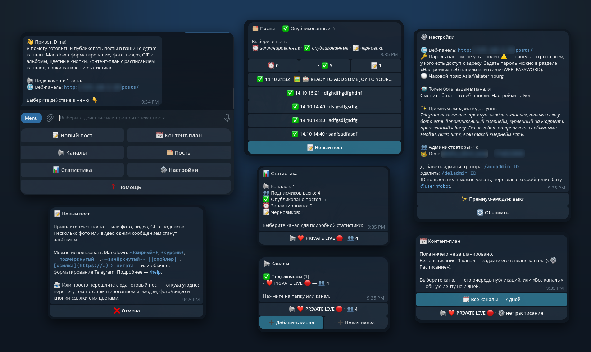</a></p>

<details>
<summary>Экраны бота по отдельности</summary>
<br>

<table>
  <tr>
    <td align="center" valign="top"><a href="docs/screenshots/bot-menu.png">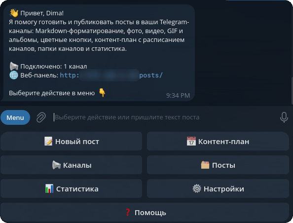</a><br><sub>Главное меню</sub></td>
    <td align="center" valign="top"><a href="docs/screenshots/bot-new-post.png">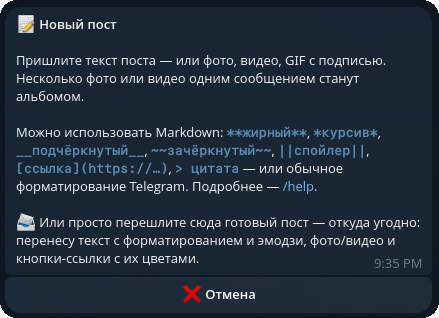</a><br><sub>Новый пост</sub></td>
    <td align="center" valign="top"><a href="docs/screenshots/bot-posts.png">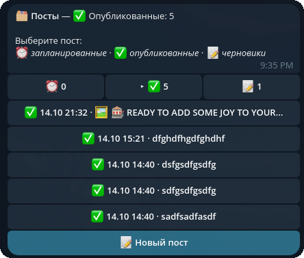</a><br><sub>Посты</sub></td>
    <td align="center" valign="top"><a href="docs/screenshots/bot-plan.png">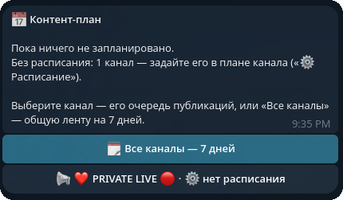</a><br><sub>Контент-план</sub></td>
  </tr>
  <tr>
    <td align="center" valign="top"><a href="docs/screenshots/bot-channels.png">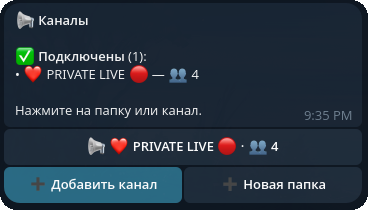</a><br><sub>Каналы и папки</sub></td>
    <td align="center" valign="top"><a href="docs/screenshots/bot-stats.png">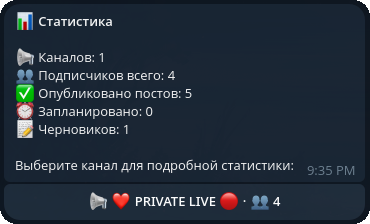</a><br><sub>Статистика</sub></td>
    <td align="center" valign="top"><a href="docs/screenshots/bot-settings.png">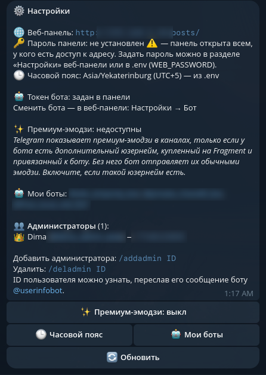</a><br><sub>Настройки</sub></td>
    <td></td>
  </tr>
</table>
</details>

**Веб-панель** (на скриншотах — демо-данные, нажмите, чтобы открыть в полном размере):

<table>
  <tr>
    <td align="center" valign="top"><a href="docs/screenshots/panel-overview.png">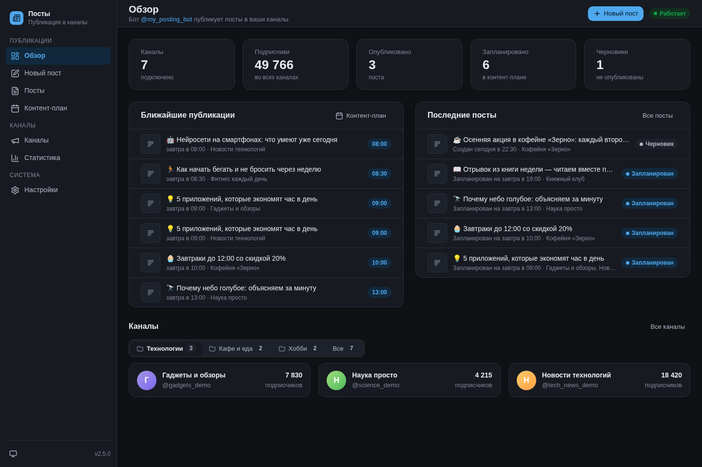</a><br><sub>Обзор</sub></td>
    <td align="center" valign="top"><a href="docs/screenshots/panel-compose.png">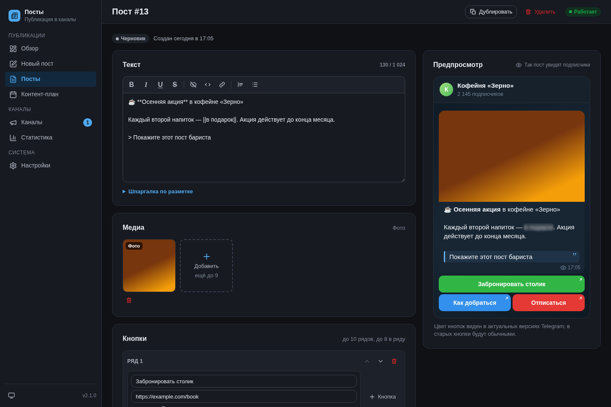</a><br><sub>Редактор поста с предпросмотром</sub></td>
    <td align="center" valign="top"><a href="docs/screenshots/panel-plan.png">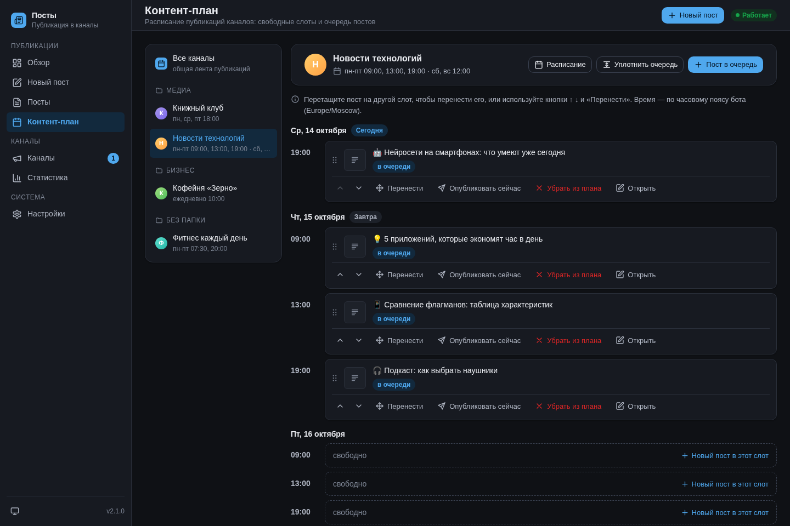</a><br><sub>Контент-план</sub></td>
  </tr>
  <tr>
    <td align="center" valign="top"><a href="docs/screenshots/panel-posts.png">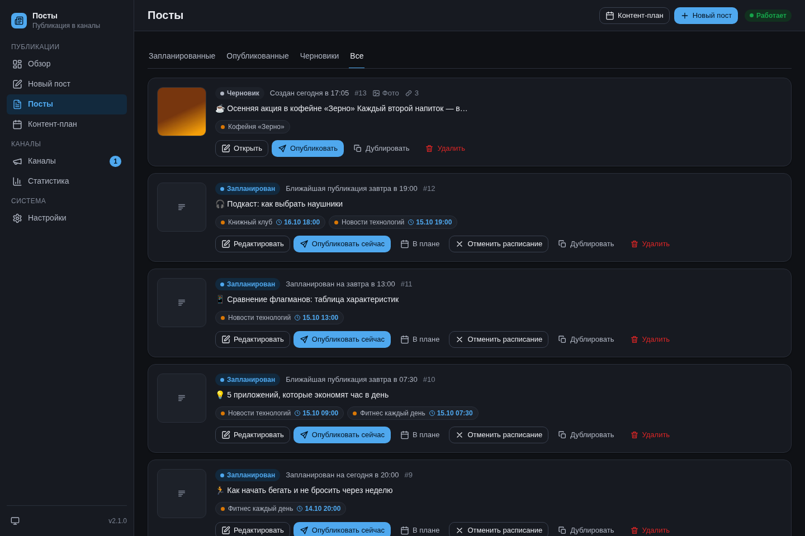</a><br><sub>Посты</sub></td>
    <td align="center" valign="top"><a href="docs/screenshots/panel-channels.png">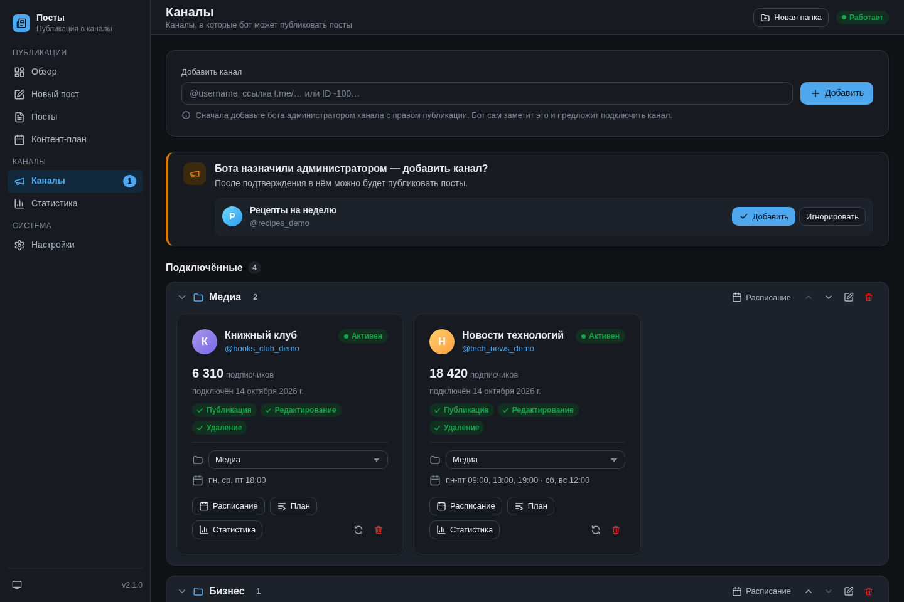</a><br><sub>Каналы и папки</sub></td>
    <td align="center" valign="top"><a href="docs/screenshots/panel-stats.png">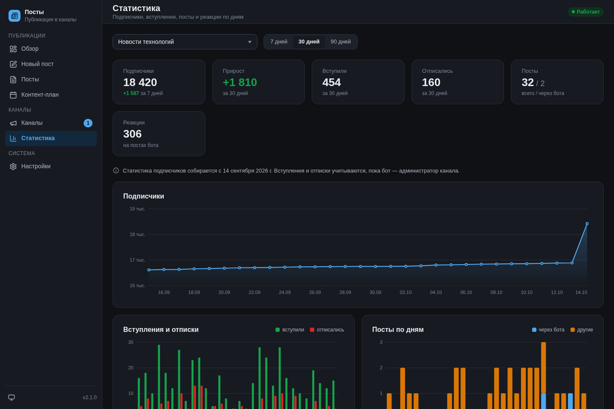</a><br><sub>Статистика</sub></td>
  </tr>
</table>

## Содержание

1. [Возможности](#возможности)
2. [Как это работает](#как-это-работает)
3. [Что понадобится](#что-понадобится)
4. [Установка на VPS — пошагово](#установка-на-vps--пошагово)
5. [Доступ к веб-панели](#доступ-к-веб-панели)
6. [Первая настройка после запуска](#первая-настройка-после-запуска)
7. [Обновление, бэкап, перенос](#обновление-бэкап-перенос)
8. [Переменные окружения](#переменные-окружения)
9. [Работа с ботом и панелью](#работа-с-ботом-и-панелью)
10. [Форматирование и кнопки](#форматирование-и-кнопки)
11. [Частые проблемы](#частые-проблемы)
12. [Локальный запуск для разработки](#локальный-запуск-для-разработки)
13. [Структура проекта](#структура-проекта)

---

## Возможности

**Посты:**
- текст с **Markdown-разметкой**: жирный, курсив, подчёркнутый, зачёркнутый, спойлер, код, ссылки, цитаты
  (в том числе сворачиваемые); обычное форматирование Telegram при отправке боту тоже сохраняется;
- **медиа**: фото, видео, GIF и **альбомы** до 10 фото и видео;
- **цветные кнопки-ссылки**: синие, зелёные, красные или обычные, в несколько рядов
  (у альбомов кнопок не бывает — это ограничение Telegram, редактор об этом предупредит);
- опции: без звука, запрет пересылки, без превью ссылок, подпись над медиа;
- предпросмотр: пост приходит вам в личку бота ровно таким, каким появится в канале;
- **готовый пост пересылкой**: перешлите боту пост из любого канала или чата — текст с форматированием и
  эмодзи, медиа и кнопки-ссылки с цветами перенесутся в черновик (только в боте);
- публикация сразу в несколько каналов; редактирование и удаление уже опубликованных постов во всех каналах сразу.

**Публикация по времени и контент-план:**
- три режима публикации: **сразу**, **ко времени** или **в очередь по расписанию**;
- у каждого канала своё недельное расписание слотов, например `пн-пт 09:00, 18:00` и `сб, вс 12:00`;
  пост «в очередь» встаёт в ближайший свободный слот каждого выбранного канала — так удобно копить запас постов
  на недели вперёд;
- контент-план по дням: занятые и свободные слоты, перенос постов (в панели — перетаскиванием), «раньше / позже»,
  «уплотнить очередь», публикация вне очереди;
- после публикации по расписанию бот присылает отчёт со ссылками на посты.

**Каналы:**
- **автообнаружение**: назначьте бота администратором канала — он сам сообщит об этом и предложит добавить канал
  одной кнопкой; если бота снимут с админки, тоже предупредит;
- **«Мои боты»**: укажите юзернеймы других своих ботов — в уведомлении о новом канале появятся кнопки «➕ @бот»:
  нажали, выбрали канал, и ваш бот тоже админ (права на публикацию, правку и удаление уже отмечены). Сам добавить
  другого бота в канал бот не может — так устроен Telegram;
- добавление вручную по `@username`, ссылке, ID или пересылке поста из канала;
- **папки каналов** — удобно, когда каналов много; при выборе каналов для поста можно отметить сразу всю папку.

**Статистика:**
- подписчики и их динамика за 1, 7 и 30 дней (графики в панели);
- вступления и отписки по дням, количество постов (своих и опубликованных через бота), реакции, лучшие посты.
- сводка по всем каналам сразу, по папке или по выбранным каналам, таблица «По каналам».

**Веб-панель:** всё то же, что в боте, плюс редактор с живым предпросмотром «как в Telegram», загрузка медиа
перетаскиванием, графики статистики. Работает на телефоне и компьютере, светлая и тёмная тема. Пароль по желанию.
Бота, который публикует посты, можно сменить прямо в панели — достаточно вставить токен нового бота
(см. [Как сменить бота](#как-сменить-бота)).

## Как это работает

```
Администратор                       Бот                                     Каналы
─────────────                       ───                                     ──────
пишет пост (в боте или в панели) ─► черновик + предпросмотр в личку
выбирает каналы и режим          ─► сразу ──────────────────────────────►  пост во всех выбранных
                                    ко времени / в очередь по слотам        каналах в своё время
                                    планировщик проверяет очередь
                                    каждые 15 секунд ───────────────────►  публикация
                                 ◄─ отчёт со ссылками на посты
```

Статусы поста: `draft` (черновик) → `scheduled` (запланирован) → `sending` (публикуется) → `sent` (опубликован).
Ещё бывают `partial` (вышел не во всех каналах — причина видна у каждого канала, можно повторить),
`failed` (не вышел) и `deleted` (удалён из каналов). Пост, поставленный в очередь сразу в несколько каналов,
может выйти в них в разное время — у каждого канала своё время и свой статус.

Фоновые задачи внутри процесса: публикация по расписанию (каждые 15 с), снимок числа подписчиков (раз в час).
Вступления, отписки, реакции и новые посты в каналах бот получает от Telegram сразу.

## Что понадобится

| Что | Зачем | Где взять |
|---|---|---|
| VPS-сервер с Linux (Ubuntu 22.04/24.04 или Debian 12) | здесь будет круглосуточно работать бот | [FirstVDS](https://firstvds.ru/?from=1187253) |
| Токен бота | чтобы бот работал от имени вашего бота | [@BotFather](https://t.me/BotFather) |
| Ваш числовой Telegram ID | чтобы бот знал, кто администратор | [@Get_myidrobot](https://t.me/Get_myidrobot) |
| Свои Telegram-каналы | куда бот будет публиковать посты | — |
| Домен *(необязательно)* | открыть веб-панель по HTTPS по красивому адресу | любой регистратор доменов |

**Требования к серверу:** 1 vCPU, 1 ГБ RAM (боту хватает ~150 МБ), 10 ГБ диска — подойдёт минимальный тариф
[FirstVDS](https://firstvds.ru/?from=1187253). Сервер должен иметь доступ к `api.telegram.org` — выбирайте расположение,
где Telegram не заблокирован.

---

## Установка на VPS — пошагово

### Шаг 1. Создайте бота в @BotFather

1. Откройте [@BotFather](https://t.me/BotFather) и отправьте `/newbot`.
2. Введите имя бота (видно в чате, например «Мои публикации»).
3. Введите username — должен заканчиваться на `bot`, например `my_posting_bot`.
4. BotFather пришлёт **токен** вида `1234567890:AAH...`. Сохраните его — это `BOT_TOKEN`.
   Никому его не показывайте: по токену можно управлять ботом.
5. *(По желанию)* оформите бота: `/setuserpic` — аватар, `/setdescription` — текст на стартовом экране.

Список команд бот выставляет сам при запуске, настраивать `/setcommands` не нужно.

### Шаг 2. Узнайте свой Telegram ID

1. Откройте [@Get_myidrobot](https://t.me/Get_myidrobot) и нажмите «Start».
2. Бот пришлёт ваш ID — число вроде `123456789`. Это `ADMIN_IDS`.
3. Если администраторов несколько — соберите ID каждого, в настройках они пишутся через запятую.
   Первый в списке становится **владельцем**: только он может добавлять и удалять других администраторов
   и сбрасывать пароль веб-панели.

Каждый администратор должен хотя бы раз нажать «Start» в **вашем** боте — иначе бот не сможет писать ему
(предпросмотры, отчёты о публикации, уведомления о новых каналах).

> Если оставить `ADMIN_IDS` пустым, владельцем станет **первый**, кто отправит боту `/start`.
> На сервере так делать не стоит — задайте ID явно.

### Шаг 3. Арендуйте VPS

1. Зарегистрируйтесь у VPS-провайдера, например [FirstVDS](https://firstvds.ru/?from=1187253), и создайте сервер:
   - ОС: **Ubuntu 24.04** (или 22.04 / Debian 12);
   - тариф: от 1 vCPU / 1 ГБ RAM;
   - доступ: по паролю root или (лучше) по SSH-ключу.
2. Запишите **IP-адрес** сервера и пароль root (или добавьте свой SSH-ключ).

### Шаг 4. Подключитесь к серверу по SSH

С Linux / macOS / Windows 10+ (PowerShell):

```bash
ssh root@IP_ВАШЕГО_СЕРВЕРА
```

При первом подключении ответьте `yes` на вопрос об отпечатке ключа и введите пароль.

### Шаг 5. Подготовьте сервер

Обновите систему и поставьте git:

```bash
apt update && apt upgrade -y && apt install -y git curl
```

Установите Docker (официальный скрипт установки):

```bash
curl -fsSL https://get.docker.com | sh
```

Проверьте, что всё установилось:

```bash
docker --version && docker compose version
```

Проверьте, что сервер видит Telegram (должен прийти JSON с `"ok":false` и ошибкой 404 — это нормально,
главное, что ответ пришёл):

```bash
curl -s https://api.telegram.org/bot/getMe
```

Включите файрвол, чтобы снаружи был открыт только SSH (и веб, если будете открывать панель через домен):

```bash
ufw allow OpenSSH && ufw --force enable
```

### Шаг 6. Скачайте бота

```bash
cd /opt
git clone https://github.com/Dosash/post_channel_bot.git
cd post_channel_bot
```

### Шаг 7. Заполните настройки

```bash
cp .env.example .env
nano .env
```

Минимально нужно заполнить:

```ini
BOT_TOKEN=1234567890:AAH...          # из шага 1
ADMIN_IDS=123456789                  # из шага 2, несколько — через запятую, первый — владелец
TIMEZONE=Europe/Moscow               # ваш часовой пояс: время публикаций и статистика

WEB_HOST=127.0.0.1                   # панель доступна только с самого сервера (см. «Доступ к веб-панели»)
WEB_PASSWORD=придумайте-длинный-пароль
```

Остальное можно оставить по умолчанию (описание всех параметров — в разделе
[Переменные окружения](#переменные-окружения)). Сохранить в nano: `Ctrl+O`, `Enter`, выйти: `Ctrl+X`.

Закройте файл от чужих глаз:

```bash
chmod 600 .env
```

### Шаг 8. Запустите

```bash
docker compose up -d --build
```

Первая сборка занимает 1–3 минуты. Контейнер называется `post-channel-bot` и будет сам перезапускаться после
сбоя и после перезагрузки сервера (`restart: unless-stopped`).

### Шаг 9. Проверьте, что бот работает

```bash
docker ps --filter name=post-channel-bot
```

Через ~30 секунд в колонке STATUS должно быть `Up ... (healthy)`.

```bash
docker logs --tail 50 post-channel-bot
```

В логе должны быть строки:
- `Веб-панель: http://127.0.0.1:8080` — панель запустилась;
- `Run polling for bot @ваш_бот` — бот подключился к Telegram.

Откройте своего бота в Telegram и отправьте `/start` — должно появиться главное меню.

> ⚠️ **Только один экземпляр бота.** Нельзя одновременно запускать бота с тем же токеном в двух местах
> (например, на сервере и у себя на компьютере): Telegram будет делить обновления между ними, в логе появится
> `TelegramConflictError`.

---

## Доступ к веб-панели

Панель встроена в бота и слушает порт `8080` (`WEB_PORT`). Из панели можно публиковать посты в ваши каналы
и управлять администраторами, поэтому **не оставляйте её открытой в интернет без пароля**. Выберите один из вариантов.

### Вариант А. SSH-туннель — просто и безопасно (без домена)

В `.env`: `WEB_HOST=127.0.0.1` — панель недоступна снаружи. Чтобы открыть её, на **своём компьютере** выполните:

```bash
ssh -N -L 8080:127.0.0.1:8080 root@IP_ВАШЕГО_СЕРВЕРА
```

и, пока команда работает, откройте в браузере http://localhost:8080. Закрыли терминал — доступ закрылся.

### Вариант Б. Свой домен + HTTPS через nginx

1. У регистратора домена создайте A-запись, например `posts.example.com` → IP сервера.
2. В `.env` оставьте `WEB_HOST=127.0.0.1`, **обязательно** задайте `WEB_PASSWORD`, а также
   `WEB_PUBLIC_URL=https://posts.example.com` и `TRUST_PROXY=1` (чтобы защита от перебора пароля видела
   настоящие IP посетителей). Перезапустите: `docker compose up -d`.
3. Установите nginx и certbot, откройте веб-порты:

   ```bash
   apt install -y nginx certbot python3-certbot-nginx && ufw allow 'Nginx Full'
   ```

4. Создайте файл сайта:

   ```bash
   nano /etc/nginx/sites-available/post-bot
   ```

   ```nginx
   server {
       listen 80;
       server_name posts.example.com;

       client_max_body_size 55m;   # загрузка видео и GIF — до 50 МБ

       location / {
           proxy_pass http://127.0.0.1:8080;
           proxy_set_header Host $host;
           proxy_set_header X-Real-IP $remote_addr;
           proxy_set_header X-Forwarded-For $proxy_add_x_forwarded_for;
           proxy_set_header X-Forwarded-Proto $scheme;
           proxy_read_timeout 600s;    # публикация больших видео и альбомов идёт несколько минут
           proxy_send_timeout 600s;
       }
   }
   ```

5. Включите сайт и получите сертификат:

   ```bash
   ln -s /etc/nginx/sites-available/post-bot /etc/nginx/sites-enabled/ && nginx -t && systemctl reload nginx
   ```

   ```bash
   certbot --nginx -d posts.example.com
   ```

6. Панель откроется по адресу `https://posts.example.com` и попросит пароль.

### Вариант В. Напрямую по IP (не рекомендуется)

`WEB_HOST=0.0.0.0`, `WEB_PASSWORD` — обязательно, `ufw allow 8080/tcp`. Адрес: `http://IP_СЕРВЕРА:8080`.
Соединение не шифруется — пароль идёт открытым текстом, поэтому лучше вариант А или Б.

### Пароль панели

- `WEB_PASSWORD` в `.env` — пароль задаётся на сервере; сменить его можно только там.
- Если `WEB_PASSWORD` пуст, пароль можно задать, сменить или убрать в самой панели: «Настройки» → «Пароль».
  Пока пароль не задан, панель открыта всем, кто до неё дотянется, — годится только для варианта А или для
  запуска у себя на компьютере.
- Забыли пароль, заданный в панели? Владелец бота сбрасывает его в боте: «⚙️ Настройки» →
  «🔑 Сбросить пароль веб-панели».

---

## Первая настройка после запуска

1. **Добавьте бота в каналы.** В каждом канале: «Управление каналом» → «Администраторы» → «Добавить
   администратора» → найдите своего бота → оставьте права **«Публикация сообщений»**, «Редактирование» и
   «Удаление сообщений» (последние два нужны, чтобы править и удалять опубликованные посты).
   Бот пришлёт «🆕 Бот назначен администратором канала…» — нажмите «✅ Добавить канал».
   Если у вас есть и другие боты для этих каналов, перечислите их в боте («⚙️ Настройки» → «🤖 Мои боты» →
   «➕ Добавить бота»: юзернейм или пересланное от бота сообщение), в панели («Настройки» → «Мои боты») или
   командой `/helperbots @first_bot @second_bot` — тогда в том же сообщении будут кнопки «➕ @бот».
2. **Каналы, где бот уже был админом до запуска**, бот сам не увидит — добавьте их вручную: в боте «📢 Каналы» →
   «➕ Добавить канал» (пришлите `@username`, ссылку или перешлите любой пост из канала) или в панели → «Каналы».
3. **Папки** *(если каналов много)*: панель → «Каналы» → «Новая папка», затем выберите папку у каждого канала.
4. **Расписание для контент-плана**: у канала → «Расписание», например `пн-пт 09:00, 13:00, 19:00` и
   `сб, вс 12:00`. Расписание можно задать сразу всей папке.
5. **Первый пост**: «📝 Новый пост» в боте или «Новый пост» в панели → предпросмотр придёт вам в личку →
   «Опубликовать».

---

## Обновление, бэкап, перенос

### Обновить бота до новой версии

```bash
cd /opt/post_channel_bot
```

```bash
git pull && docker compose up -d --build
```

Изменения структуры базы применяются автоматически при старте. Данные (`data/`) и настройки (`.env`)
при обновлении не трогаются. Запланированные посты сохраняются; если какой-то пост в момент перезапуска
публиковался, бот после старта пометит его как прерванный, и его можно будет допубликовать.

Чтобы иметь возможность откатиться, **до** сборки сохраните текущий образ:

```bash
docker tag post-channel-bot:latest post-channel-bot:backup
```

### Бэкап

Всё (каналы, папки, посты, расписание, статистика, настройки панели) — в файле `data/bot.db`, загруженные через
панель медиа — в `data/uploads/`. Если бот сменён в панели, в базе хранится и его токен — **копии базы секретны**,
как `.env`. Безопасная копия базы на работающем боте:

```bash
mkdir -p /root/backups && docker exec post-channel-bot .venv/bin/python -c "import sqlite3;s=sqlite3.connect('data/bot.db');d=sqlite3.connect('data/backup.db');s.backup(d)" && mv data/backup.db /root/backups/bot-$(date +%Y%m%d-%H%M).db
```

Скачать копию к себе на компьютер:

```bash
scp root@IP_ВАШЕГО_СЕРВЕРА:/root/backups/bot-*.db .
```

### Перенос на другой сервер

1. Арендуйте новый сервер (например, на [FirstVDS](https://firstvds.ru/?from=1187253)) и пройдите на нём шаги 4–7 (тот же `.env`).
2. Остановите бота на старом сервере: `docker compose down`.
3. Скопируйте папку `data/` со старого сервера в папку бота на новом.
4. Запустите бота на новом сервере: `docker compose up -d --build`.

### Полезные команды

| Что | Команда |
|---|---|
| Логи в реальном времени | `docker logs -f post-channel-bot` |
| Только ошибки за час | `docker logs --since 1h post-channel-bot 2>&1 \| grep -E 'ERROR\|WARNING\|Traceback'` |
| Перезапустить | `docker compose restart` |
| Остановить | `docker compose down` |
| Применить изменения `.env` | `docker compose up -d` |
| Состояние | `docker ps --filter name=post-channel-bot` и `curl -s http://127.0.0.1:8080/api/health` |

---

## Переменные окружения

Все настройки — в файле `.env` (шаблон — `.env.example`). После изменения: `docker compose up -d`.

| Переменная | По умолчанию | Описание |
|---|---|---|
| `BOT_TOKEN` | — | **Обязательно.** Токен бота от @BotFather. Бота можно сменить в панели («Настройки» → «Бот») — тогда `BOT_TOKEN` остаётся запасным. |
| `ADMIN_IDS` | пусто | Telegram ID администраторов через запятую; первый — владелец. Пусто — владельцем станет первый, кто отправит `/start`. |
| `TIMEZONE` | `UTC` | Часовой пояс расписания, контент-плана и статистики, например `Europe/Moscow`. Можно поменять без перезапуска в панели («Настройки» → «Часовой пояс») или в боте (`/timezone`) — тогда значение из `.env` остаётся запасным. |
| `WEB_HOST` | `127.0.0.1` | Адрес веб-панели. `127.0.0.1` — только с самого сервера; `0.0.0.0` — из сети (только с паролем!). |
| `WEB_PORT` | `8080` | Порт веб-панели. |
| `WEB_PASSWORD` | пусто | Пароль входа в панель. Пусто — пароль задаётся в самой панели (или панель открыта без пароля). |
| `WEB_PUBLIC_URL` | пусто | Публичный адрес панели (`https://posts.example.com`) — для ссылок из бота. |
| `WEB_PREFIX` | пусто | Путь панели, если она открыта не в корне сайта: `/posts` → `https://example.com/posts/`. Пусто — в корне. |
| `HUB_URL` | пусто | Ссылка «← Все панели» в меню панели (когда за одним nginx несколько панелей), например `/`. Пусто — без ссылки. |
| `TRUST_PROXY` | `0` | `1` — доверять заголовку `X-Forwarded-For` от nginx (вариант Б). Без прокси не включайте. |
| `DB_PATH` | `data/bot.db` | Путь к базе SQLite. В Docker — `/app/data/bot.db` (папка `data/` — том). |
| `UPLOADS_DIR` | `data/uploads` | Папка для медиа, загруженных через панель. В Docker — `/app/data/uploads`. |
| `LOG_LEVEL` | `INFO` | Подробность логов: `DEBUG`, `INFO`, `WARNING`, `ERROR`. |

---

## Работа с ботом и панелью

### Меню бота

| Кнопка | Что там |
|---|---|
| **📝 Новый пост** | Пришлите текст, фото, видео, GIF или альбом. Бот покажет предпросмотр и панель редактора: текст, медиа, кнопки, каналы, опции, публикация. |
| **📅 Контент-план** | План публикаций по каналам: ближайшие посты и свободные слоты, «раньше / позже», перенос, публикация сейчас, расписание канала, «уплотнить очередь». |
| **📢 Каналы** | Каналы по папкам, добавление каналов, папки, расписание канала, ожидающие подтверждения каналы. |
| **🗂 Посты** | Запланированные, опубликованные и черновики: открыть, отредактировать, опубликовать сейчас, перенести, удалить из каналов, дублировать. |
| **📊 Статистика** | Подписчики и динамика, вступления и отписки, посты, реакции, лучшие посты за 7 / 30 / 90 дней. |
| **⚙️ Настройки** | Адрес панели, пароль панели, откуда взят токен бота (из `.env` или задан в панели; сменить бота — в веб-панели), премиум-эмодзи (вкл/выкл), администраторы (`/addadmin ID`, `/deladmin ID` — только владелец), часовой пояс, «🤖 Мои боты» (добавить / убрать ботов, `/helperbots`). |

Команды: `/new`, `/channels`, `/posts`, `/stats`, `/settings`, `/help`, `/cancel` (выйти из любого шага).

### Режимы публикации

- **Сразу** — пост уходит во все выбранные каналы немедленно.
- **Ко времени** — одно время для всех каналов. Время можно писать как удобно: `18:30`, `25.12 10:00`,
  `завтра 9:00`, `+2h`, `через 30 минут`.
- **В очередь по расписанию** — каждый канал получает свой ближайший свободный слот из своего расписания.
  Перед подтверждением бот и панель покажут, когда пост выйдет в каждом канале. Канал без расписания в очередь
  поставить нельзя — сначала задайте ему слоты.

### Расписание канала

Одна строка — дни и время, строк может быть несколько:

```
пн-пт 09:00, 13:00, 19:00
сб, вс 12:00
```

Понимает `ежедневно`, `будни`, `выходные`, диапазоны (`пн-пт`, `пт-пн`) и списки (`сб, вс`); строка только
со временем — на каждый день. В панели расписание можно собрать и мышкой: время-«чипсы» по дням недели и
готовые шаблоны.

### Разделы веб-панели

| Раздел | Что там |
|---|---|
| **Обзор** | Подписчики, опубликовано и запланировано; каналы, ожидающие подтверждения; ближайшие публикации и последние посты; каналы по папкам (переключатель папок, выбор запоминается). |
| **Новый пост** | Редактор: Markdown с панелью форматирования, загрузка медиа (перетаскиванием или вставкой из буфера), альбомы, редактор цветных кнопок, выбор каналов по папкам, опции и три режима публикации. Справа — живой предпросмотр «как в Telegram». «Отправить мне превью» присылает пост вам в бота. |
| **Посты** | Запланированные, опубликованные, черновики: редактирование (в том числе уже опубликованных — изменения применятся во всех каналах), публикация сейчас, отмена расписания, удаление из каналов, дублирование. |
| **Контент-план** | По каналу: дни, слоты, посты в слотах; перетаскивание поста в другой слот, «раньше / позже», «перенести», «опубликовать сейчас», «убрать из плана»; клик по свободному слоту — новый пост на это время. «Все каналы» — общая лента публикаций. |
| **Каналы** | Папки (создать, переименовать, порядок, расписание для всей папки, удалить), каналы с подписчиками и правами бота, расписание канала, добавление вручную. |
| **Статистика** | Графики подписчиков, вступлений и отписок, постов по дням; реакции; лучшие посты. |
| **Настройки** | Бот: какой бот публикует посты, откуда его токен, «Сменить бота» по токену и «Вернуть бота из .env» (см. [Как сменить бота](#как-сменить-бота)). «Премиум-эмодзи» — есть ли у бота юзернейм с Fragment. «Мои боты» — другие ваши боты, которых предлагать добавить в новые каналы. Пароль панели, администраторы, версия и часовой пояс. |

### Как сменить бота

Бота, от имени которого выходят посты, можно заменить другим прямо в панели — без правки `.env` и без
доступа к серверу: «Настройки» → «Бот» → «Сменить бота».

1. Получите токен в [@BotFather](https://t.me/BotFather): `/newbot` — создать нового бота, `/token` — токен
   уже существующего. Токен выглядит как `123456789:AA…`.
2. Вставьте токен и подтвердите. Панель проверит его в Telegram (токен должен быть принят и это должен быть
   другой бот) и сохранит.
3. Бот перезапустится сам — это занимает несколько секунд, панель обновится, когда новый бот заработает.
   Посты, расписание и статистика сохраняются; отложенные посты выйдут по расписанию уже от нового бота.
4. Новый бот проверит все каналы: где он не администратор, канал получит статус «Нет доступа». Добавьте нового
   бота администратором каждого канала с правом **«Публикация сообщений»** (и «Редактирование», «Удаление
   сообщений»), затем нажмите у канала «Проверить снова» в разделе «Каналы». А каналы со статусом «Нет доступа»,
   где новый бот — администратор с правом публикации, снова станут активными (например, если вы вернули
   прежнего бота). Итог проверки бот пришлёт администраторам.
5. **Все администраторы должны нажать `/start` в новом боте** — иначе он не сможет присылать им превью,
   отчёты и уведомления.
6. Фото и видео, которые присылали прежнему боту в Telegram, новому боту недоступны (идентификаторы файлов
   Telegram у каждого бота свои) — загрузите их заново. Файлы, загруженные через панель, отправятся сами.
7. Посты, опубликованные прежним ботом, новый бот изменить не сможет — Telegram разрешает править только свои
   сообщения. Удалить их он может, если у него есть право «Удаление сообщений».

«Вернуть бота из .env» сначала проверяет `BOT_TOKEN` из `.env` в Telegram — если Telegram его не принимает,
панель покажет ошибку и ничего не изменит. Иначе токен, заданный в панели, удаляется, и бот перезапускается с
`BOT_TOKEN` из `.env`.
Если при запуске Telegram не примет токен из панели (например, его перевыпустили в @BotFather), бот
запустится с токеном из `.env`, а в «Настройках» появится предупреждение. `BOT_TOKEN` в `.env` по-прежнему
обязателен — это запасной вариант.

> Токен, заданный в панели, хранится в базе `data/bot.db`. Относитесь к базе и её копиям как к `.env`: не
> выкладывайте их и не пересылайте.

### Что важно знать

- **Просмотры постов** Telegram Bot API не отдаёт — смотрите их в самом Telegram (статистика канала).
- **Вступления и отписки** считаются с момента, когда бот стал администратором канала.
- **Кнопки у альбомов** Telegram не поддерживает — оставьте одно фото/видео или уберите кнопки.
- **Тип опубликованного поста** (текст / одно медиа / альбом) поменять нельзя: Telegram не умеет превращать текстовое
  сообщение в фото и наоборот. Текст, кнопки и само медиа (фото ↔ видео ↔ GIF) менять можно.
- **Размеры файлов**: через панель — фото до 10 МБ, видео и GIF до 50 МБ (лимит Bot API). Через бота можно
  присылать файлы любого размера, который принимает Telegram.
- **Премиум-эмодзи** в постах бота Telegram показывает, только если у бота есть дополнительный юзернейм,
  купленный на [Fragment](https://fragment.com) (за TON) и привязанный к боту. Без него бот отправляет их
  обычными эмодзи, а редактор предупреждает об этом. Если юзернейм есть — включите «Настройки» →
  «Премиум-эмодзи» в панели (или «⚙️ Настройки» → «✨ Премиум-эмодзи» в боте).
- **Истории** в каналы Bot API публиковать не позволяет (только от имени бизнес-аккаунтов), поэтому их в боте нет.

---

## Форматирование и кнопки

### Markdown

| Пишете | Получаете |
|---|---|
| `**жирный**` | **жирный** |
| `*курсив*` или `_курсив_` | *курсив* |
| `__подчёркнутый__` | подчёркнутый |
| `~~зачёркнутый~~` | ~~зачёркнутый~~ |
| `\|\|спойлер\|\|` | скрытый текст |
| `` `код` `` | `код` |
| ```` ```python ... ``` ```` | блок кода с подсветкой языка |
| `[текст](https://example.com)` | ссылка |
| `` | премиум-эмодзи (в каналах — только если у бота есть юзернейм с Fragment) |
| `> цитата` | цитата |
| `>> цитата` | сворачиваемая цитата |
| `# Заголовок` | жирная строка |
| `- пункт` | • пункт |

Обычное форматирование Telegram (выделить текст → «Жирный» и т. п.) при отправке поста боту тоже сохраняется.
Чтобы вывести служебный символ буквально, поставьте перед ним `\`, например `\*`.

### Кнопки

Одна строка — один ряд кнопок, кнопки в ряду разделяются ` | `:

```
Наш сайт - https://example.com
Купить - https://shop.example.com - зелёная | Поддержка - @support_bot - синяя
🔴 Отписаться - https://t.me/example
```

Цвет задаётся словом в конце (`зелёная`, `синяя`, `красная`) или эмодзи 🟢 🔵 🔴 в начале текста кнопки.
Ссылка может быть `https://…`, `t.me/…` или `@username`. В панели кнопки собираются в визуальном редакторе.

---

## Частые проблемы

| Симптом | Причина и решение |
|---|---|
| Контейнер постоянно перезапускается, в логе `BOT_TOKEN не задан` | Не заполнен `BOT_TOKEN` в `.env`. |
| `Telegram не принял BOT_TOKEN` в логе | Неверный токен или его перевыпустили в @BotFather. Обновите `BOT_TOKEN`. |
| «Токен из панели не принят Telegram» в «Настройках» | Токен бота, заданный в панели, перевыпустили или бота удалили — бот работает с `BOT_TOKEN` из `.env`. Задайте новый токен в «Настройки» → «Бот» или нажмите «Вернуть бота из .env». |
| После смены бота каналы со статусом «Нет доступа» | Новый бот не администратор этих каналов. Добавьте его администратором с правом публикации и нажмите у канала «Проверить снова» в «Каналах». |
| «Медиа загружено через другого бота» | Файл присылали прежнему боту в Telegram — новый бот не может его отправить. Загрузите файл заново (в боте или в панели). |
| `TelegramConflictError` в логе | Бот с этим токеном запущен где-то ещё (например, у вас на компьютере). Остановите второй экземпляр. |
| Бот не отвечает, в логе таймауты к `api.telegram.org` | С сервера недоступен Telegram. Проверьте `curl -s https://api.telegram.org`; при блокировке нужен сервер в другом расположении, например на [FirstVDS](https://firstvds.ru/?from=1187253). |
| Бот молчит в ответ на `/start` | Ваш ID не указан в `ADMIN_IDS` — бот приватный и отвечает только администраторам. |
| Бот не прислал «Бот назначен администратором канала» | Бот уже был админом до запуска или уведомление ушло, пока бот был выключен. Добавьте канал вручную. |
| Премиум-эмодзи в канале стали обычными | У бота нет дополнительного юзернейма с [Fragment](https://fragment.com) — без него Telegram не показывает премиум-эмодзи в постах бота. Купите и привяжите юзернейм, затем включите «Настройки» → «Премиум-эмодзи». |
| «Нет прав на публикацию» в отчёте | У бота нет права «Публикация сообщений» в этом канале. Для правки и удаления постов нужны также «Редактирование» и «Удаление сообщений». |
| «У канала не настроено расписание» | Чтобы ставить посты в очередь, задайте каналу слоты: «📢 Каналы» → канал → «📅 Расписание» (или в панели). |
| Время публикаций «съехало» на несколько часов | Неверный `TIMEZONE` в `.env`. Укажите свой пояс, например `Europe/Moscow`, и перезапустите. |
| Панель не открывается | Проверьте `WEB_HOST`, `WEB_PORT`, SSH-туннель или nginx. На сервере: `curl -sI http://127.0.0.1:8080`. |
| Панель пишет «Откройте панель по адресу…» | Без пароля панель отвечает только на `localhost`, IP или `WEB_PUBLIC_URL` (защита от DNS-rebinding). Задайте пароль или откройте панель по IP / через туннель. |
| Не загружается видео в панели | Файл больше 50 МБ или не MP4/MOV — пришлите его боту в Telegram, там лимит больше. Через nginx проверьте `client_max_body_size`. |

---

## Локальный запуск для разработки

Нужен Python 3.12+ и [uv](https://docs.astral.sh/uv/).

```bash
uv sync
```

```bash
cp .env.example .env
```

Заполните `.env` (для разработки удобно завести отдельного тестового бота), затем:

```bash
uv run python -m app
```

Панель: http://localhost:8080. База создаётся в `data/bot.db` автоматически.
Панель — статичный JS без сборки (`app/web/static/`), правки видны после обновления страницы.

Тесты (Telegram в них не вызывается — используется фейковый бот):

```bash
uv run pytest -q
```

## Структура проекта

| Путь | Что |
|---|---|
| `app/__main__.py` | запуск: БД, бот, планировщик, веб-панель |
| `app/config.py` | чтение настроек из `.env` |
| `app/db.py` | схема SQLite и запросы; миграции применяются при старте |
| `app/markdown.py` | Markdown → HTML Telegram (и обратно) |
| `app/buttons.py` | разбор и сборка цветных кнопок |
| `app/media.py` | правила для медиа: фото, видео, GIF, альбомы |
| `app/services/posting.py` | отправка, публикация, редактирование и удаление постов |
| `app/services/scheduler.py` | планировщик: публикация по времени, снимки подписчиков |
| `app/services/plan.py` | расписание каналов, очередь и контент-план |
| `app/services/folders.py` | папки каналов |
| `app/services/channels.py` | добавление каналов, права бота, автообнаружение |
| `app/services/helper_bots.py` | «Мои боты»: ссылки «добавить бота админом канала» |
| `app/services/stats.py` | статистика каналов |
| `app/bot/` | бот: меню, редактор постов, каналы, контент-план, статистика, настройки |
| `app/web/` | API веб-панели, вход по паролю; `static/` — панель (HTML, JS, CSS без сборки) |
| `tests/` | тесты (pytest) |
| `Dockerfile`, `docker-compose.yml` | сборка и запуск в Docker |
| `.env.example` | шаблон настроек |

## Лицензия

Проект распространяется под лицензией [MIT](LICENSE): его можно свободно использовать, изменять и распространять,
в том числе в коммерческих целях, при условии сохранения текста лицензии и указания авторства.

## Благодарность автору

Если бот вам пригодился, я буду благодарен за ссылку на автора ([Dosash](https://github.com/Dosash)) или на этот репозиторий
([github.com/Dosash/post_channel_bot](https://github.com/Dosash/post_channel_bot)): в описании своего бота, в канале или в своём проекте на основе
этого кода. Это не обязательно, но очень приятно. ⭐ на GitHub тоже помогает.

## Поддержка

Вопросы, идеи и сообщения об ошибках — в [Issues](https://github.com/Dosash/post_channel_bot/issues) или на любой из площадок ниже:

[](https://dosash.ru)
[](https://twitch.tv/dosash)
[](https://kick.com/dosash1)
[](https://youtube.com/@dosash)
[](https://discord.gg/WubwwU2bpM)

## 💖 Поддержать

Если бот пригодился: [CloudTips](https://pay.cloudtips.ru/p/894f4248) (карта) или [Telegram-кошелёк](https://t.me/send?start=IVoQmPAfgWnM) (крипта).
